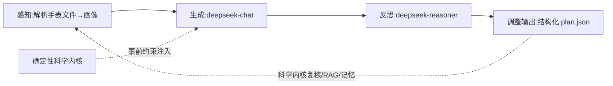

# 马拉松训练计划 Agent · 架构设计梳理

> 从第一性原理出发，覆盖项目目标、前端架构、后端架构（核心）与选型理由。文中结论均基于实际代码调研（`app.py`、`llm_agent.py`、`rag.py`、`routes/coach.py`、`README.md`、`requirements.txt` 及前端结构探索），附文件路径与代码证据。

---

## 一、项目目标：它解决什么核心问题

**第一性原理定义（README）：Agent = 感知 → 推理 → 行动 → 反馈 的闭环系统。**

- **目标用户**：拥有运动手表（Garmin 等）的大众跑者，正备战半马 / 全马。
- **核心痛点**：他们积累了真实跑步数据，却缺乏科学、安全、可执行的训练安排；私教贵、资料杂、通用 App 不看个人真实数据。
- **核心问题**：把"真实数据"转化为"科学、安全、循序渐进的训练计划"，并随执行情况自我审查、动态调整。
- **差异化价值（3 点）**：
  1. **零 API 门槛**：从手表导出 GPX/TCX/FIT 文件或手动填 JSON 即用，无需注册任何第三方 API。
  2. **自我反思**：生成后由推理模型审查再输出，落地吴恩达"精心设计的 Agentic 工作流能让弱模型超越强模型"的洞察。
  3. **确定性科学内核兜底**：训练安全不能靠 LLM 自由发挥，单独建确定性内核做硬约束（防伤病）。

---

## 二、全局分层架构（鸟瞰）

```
① 前端展示层    Flask MPA · Jinja2 服务端渲染 · 原生 JS 渐进增强 · Chart.js/Lucide
② API 路由层    5 个 Flask 蓝图：pages / data / plan / coach(SSE) / eval
③ Agent 编排层   DeepSeek 双模型 + 状态机 + 工具 + RAG + 记忆（核心大脑）
④ 确定性科学内核 physiology / plan_science / training_science（纯标准库，无副作用）
⑤ 数据与知识层   GPX/TCX/FIT 解析 · plan.json / 记忆 JSON · ChromaDB 向量库
```

- 请求自上而下，响应自下而上。
- `design/` 是设计稿"源真理"，`showcase/` 是独立演示，二者**不参与运行时**；运行时前端只有 `templates/` + `static/`。

---

## 三、前端架构：Flask MPA + SSR + 原生 JS 渐进增强

**技术栈**：Flask 模板（Jinja2）+ 原生 JS（IIFE + `window` 命名空间）+ 少量 CDN（Chart.js@4、Lucide）。**无 React/Vue，无 webpack/vite，无 package.json。**

**运作逻辑（两段式）**：
1. **首屏服务端渲染**：`templates/base.html` 为公共骨架（顶栏 + 侧栏 + 移动底栏），各页面 ``；后端 `render_template` 时把跑者画像、计划数据直接注入，浏览器拿到即完整 HTML（首屏快、无白屏）。
2. **交互靠原生 JS 增强**：`static/` 下 JS 模块（如 `window.COACH.plan`、`window.PlanCalendar`）通过 `fetch('/generate')`、`fetch('/api/plan/update_day')` 做局部更新；教练对话用 **SSE** 接收流式回复。CSS 分三层：`theme.css`（主题 token）、`design-system.css`（设计原语）、`execution.css`。

**选型理由（第一性原理）**：

| 选型 | 决策 | 理由 |
|------|------|------|
| MPA 而非 SPA | 5 个功能页各自独立，跳转不频繁 | 无需 SPA 路由/状态管理复杂度 |
| SSR 而非前端渲染 | 数据在后端（Python 画像/计划） | Jinja2 注入是最短路径，省一次 API 往返 |
| 原生 JS 而非框架 | 交互点有限（生成、打卡、对话） | 无构建链、零依赖，`git clone` 即跑，契合"教学演示"定位 |
| SSE 而非 WebSocket | 对话只需服务端→客户端单向流 | SSE 更轻、基于 HTTP，实现成本最低 |

---

## 四、后端架构（核心）：确定性内核 + LLM 双脑

**技术栈**：Flask 3 + OpenAI SDK（调 DeepSeek）+ ChromaDB + sentence-transformers + matplotlib，纯 Python 单进程。

**架构模式不是普通 CRUD 分层，而是 Agentic 编排 + 确定性科学内核并行的"双脑"模式。**

### 脑 A · 确定性科学内核（第 ④ 层）
- `physiology.py` / `plan_science.py` / `training_science.py`：纯标准库实现，无 LLM 调用、可复现。量化 TRIMP 训练负荷、ACWR 急慢性负荷比（伤病风险）、心率区间、配速换算等。
- 在闭环里扮演**两次护栏**：
  - **事前**：`plan_science.build_constraints` 在调 LLM 前算出科学约束，注入 prompt 指导计划（`llm_agent.py:578-591`）。
  - **事后**：`plan_science.enrich_plan` 用内核复核并增强结构化计划（`llm_agent.py:644-661`）。
- 全程"可降级"：任何异常 `try/except` 兜底，不影响主流程。

### 脑 B · LLM 双模型（第 ③ 层，`llm_agent.py`）
对应吴恩达 Agentic 模式：
- **生成用 `deepseek-chat`**，强制 `response_format={"type":"json_object"}` 输出结构化 JSON；解析时"JSON 优先 + 正则兜底"双保险（`_parse_plan_full`），前端永远拿不到裸 JSON。
- **反思用 `deepseek-reasoner`**（带思维链），由 `prompts/plan_reflector_system.md` 等提示词审查并调整计划。
- 底层 `call_deepseek` 封装指数退避重试、客户端单例、reasoner 不支持 temperature 的自动处理。

### Agent 编排三大高级能力（集中于 `routes/coach.py`）
| 能力 | 实现 | 设计巧思 |
|------|------|----------|
| 状态机 + 意图分类 | `workflow.py` + `classify_intent` | 先关键词快速匹配（省 ~1s 延迟），未命中才调 LLM；意图驱动 chat/assess/advise/plan/track 转换 |
| 工具使用 | `skills.py` + `[TOOL:xxx]` 标记 | LLM 回复带工具标记 → 后端执行 → 结果回灌再生成，最多 2 轮循环 |
| RAG 知识增强 | `rag.py` + ChromaDB | 知识库按 `##` 分块（600 字/100 字重叠）+ 多语言向量模型，检索运动科学知识注入上下文 |
| 长期记忆 | `memory.py` | 记住跑者偏好 + 对话历史（最近 10 轮），原子写入 JSON |
| 流式响应 | SSE（`text/event-stream`） | 教练回复逐字推送，体验接近打字机 |

**核心闭环（mermaid）**：


---

## 五、数据与知识层（第 ⑤ 层）

- **文件解析**（`parsers/` 策略模式）：GPX（gpxpy）/ TCX（标准库 xml）/ FIT（fitparse）/ CSV 四种格式。
- **持久化用文件系统而非数据库**：计划存 `plan.json`，记忆存 JSON，向量库持久化到 `data/chroma_db/`。
- 该选型决定了部署方式：有状态应用，**不能直接上云函数（临时磁盘丢数据）**——对应既有部署结论（轻量云服务器 + Docker Compose）。

---

## 六、选型理由一句话总结

最朴素的 Flask MPA 外壳（易跑易懂），包裹一个**确定性科学内核 + LLM 双模型**的双脑智能体（计划既智能又安全），完整实现"感知真实数据 → 推理生成 → 反思审查 → 动态调整"的 Agent 闭环。每个选型都指向同一目标：**让普通跑者零门槛用上科学、安全、会自我进化的 AI 教练。**

---

## 七、后续可演进方向（可选，非本次交付）
1. 多用户 / 账号体系（当前为单用户文件存储）。
2. 数据库化（PostgreSQL / SQLite）以支持并发与多租户。
3. 部署升级（轻量云 + Docker Compose → 多实例 + 云数据库 + CDN，对应日活数百+ 信号）。
4. 前端组件化（若交互复杂度上升，可考虑引入轻量框架或 HTMX）。
