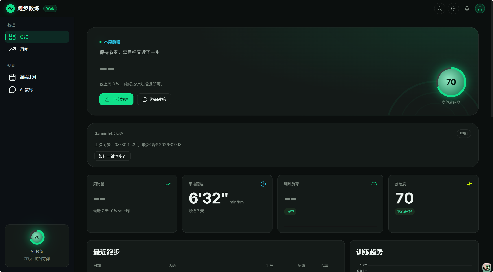
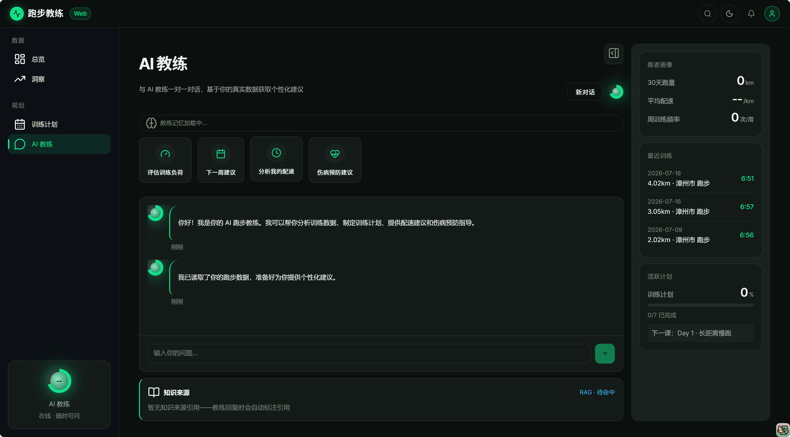
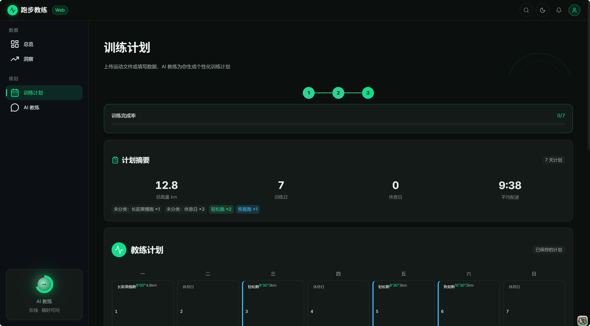
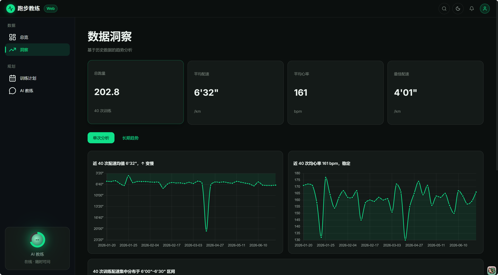
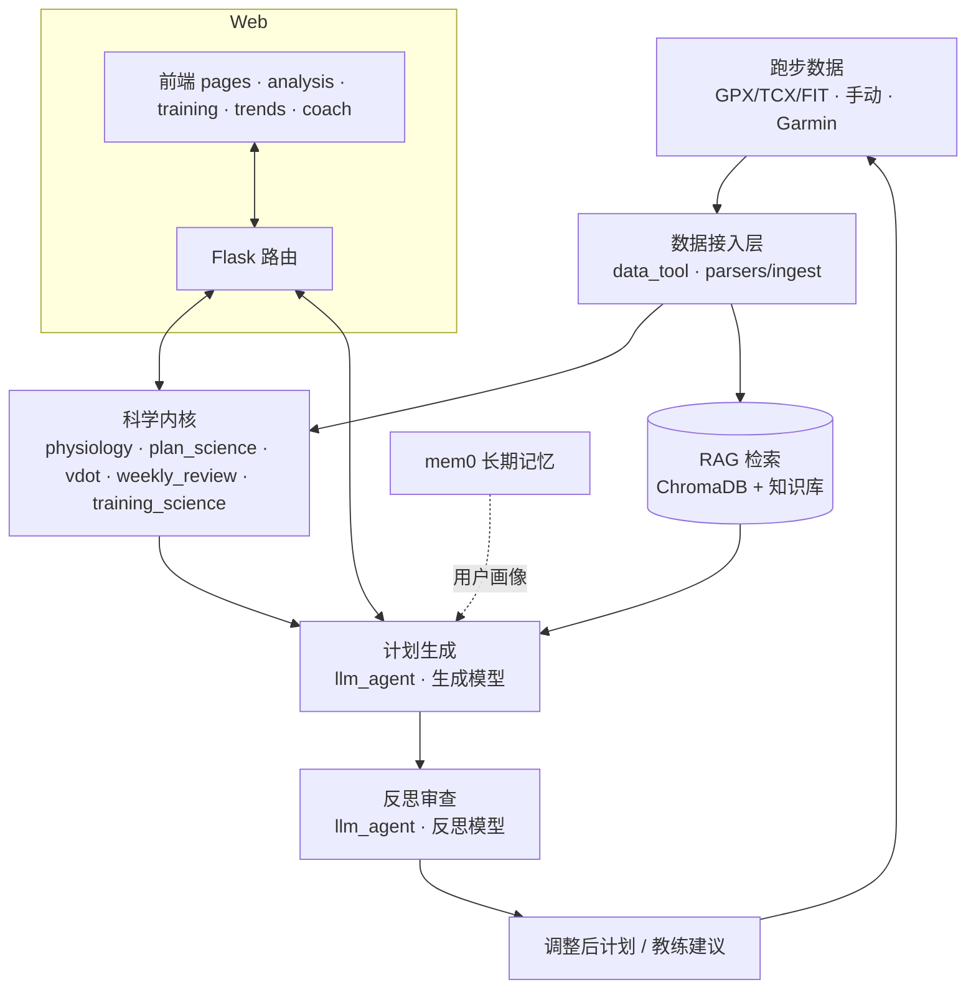

# 🏃 马拉松训练计划 Agent

> 从第一性原理出发的 AI 跑步教练：读取你的真实跑步数据，生成训练计划，并自我反思、动态调整——把「科学训练」从经验玄学，变成**可推导、可复盘**的系统。

<p align="center">
  
  
  
  
  
  
</p>

**无需注册任何 API 账号**——从手表导出的运动文件，或手动填写数据，即可开始。

> 源码：[github.com/haoxue123/run-flask-agent](https://github.com/haoxue123/run-flask-agent) ｜ 文档站点：[haoxue123.github.io/run-flask-agent](https://haoxue123.github.io/run-flask-agent)

---

## 📑 目录

- [✨ 特性](#-特性)
- [🎬 演示](#-演示)
- [🔁 核心闭环](#-核心闭环)
- [🏗️ 架构](#-架构)
- [🚀 快速开始](#-快速开始)
- [🧪 训练科学内核](#-训练科学内核)
- [📥 数据接入](#-数据接入)
- [🐳 部署](#-部署)
- [🗺️ 路线图](#-路线图)
- [🎯 设计哲学](#-设计哲学)
- [❓ 常见问题](#-常见问题)
- [⭐ Star History](#-star-history)
- [📄 许可证](#-许可证)

## ✨ 特性

- 🤖 **自适应教练闭环** — 计划 → 执行 → 复盘 → 调整，不是一次性计划生成器，而是陪你长期进步的教练。
- 📐 **VDOT 科学配速** — 由近期比赛成绩推导有氧能力（VDOT），反推 E / M / T / I / R 各区配速；LLM 输出被配速锚点约束，不再「凭记忆编」。
- 📊 **多源数据接入** — 支持 GPX / TCX / FIT 文件解析与手动输入，自动读取**全量**历史（已修复早期 5 条截断）。
- 🔍 **RAG 知识库** — ChromaDB + 25 篇跑步科学 Markdown，问答有据可依，不胡说。
- 🔄 **周复盘闭环** — 实际执行与计划对齐，计算完成率与负荷，给出客观的增减量建议；未匹配数据时明确提示，不静默清零。
- 🌊 **流式大文件摄入** — 生成器逐 record 读取 FIT，跨文件内存恒定，单文件失败隔离，适合多年活动批量上传。
- 🔐 **Garmin 同步（浏览器引擎）** — Playwright 真实浏览器绕过 Cloudflare + MFA，首次可见登录后无头复用下载。
- 📈 **可视化分析** — 配速曲线、心率区间、跑量 / VO2max / 训练负荷趋势图表。
- 🧠 **长期记忆** — mem0 记录你的偏好与历史对话，越用越懂你。

## 🎬 演示

| 数据总览 | AI 教练 |
|---|---|
|  |  |

| 训练计划 | 数据洞察 |
|---|---|
|  |  |

> 截图来自本地运行实例：http://127.0.0.1:5000

## 🔁 核心闭环


工具使用让 AI 感知真实世界，反思让计划持续逼近科学——这是本项目的最小可行闭环。

## 🏗️ 架构



详细架构梳理见 [ARCHITECTURE.md](./ARCHITECTURE.md)。

## 🚀 快速开始

### 1. 安装依赖

```bash
pip install -r requirements.txt
```

### 2. 配置密钥

将 `.env.example` 复制为 `.env`，填入 DeepSeek API Key：

```bash
# Windows PowerShell
Copy-Item .env.example .env
```

只需 `DEEPSEEK_API_KEY`（在 [platform.deepseek.com](https://platform.deepseek.com) 申请，新用户有免费额度）。

### 3. 准备数据（二选一）

**方式 A：导入运动文件（推荐）**
从 Garmin Connect 等导出 GPX / TCX / FIT，放入 `data/` 目录，自动按日期排序读取全量记录。

**方式 B：手动填写**

```bash
Copy-Item data/manual_input.example.json data/manual_input.json
```

编辑 `data/manual_input.json` 填写近期跑步数据（配速支持 `"6:17"` 写法）。想激活 VDOT 配速，记得填「近期比赛成绩」。

### 4. 启动

```bash
python app.py
```

浏览器访问 http://127.0.0.1:5000 即可使用。

## 🧪 训练科学内核

### VDOT 配速校准（确定性内核）

教练不再凭记忆编配速。你只需在 `data/manual_input.json` 填「近期比赛成绩」（如 10km / 40 分），`vdot.py` 用 Daniels《Running Formula》的 VDOT 方程反推你的有氧能力，再按各强度区占 vVO2max 的百分比（E 59–74% / M 80% / T 88% / I 100% / R 106%）算出 E / M / T / I / R 训练配速。

> 示例：VDOT≈52（约 10km 40 分）对应 M 约 4:20、T 约 3:50、I 约 3:25 /km。该配速块会注入教练对话与计划生成，作为锚点约束 LLM 输出。

### 周复盘闭环（自适应调整）

`weekly_review.py` 把「实际执行数据」与 `plan.json` 的起止窗口对齐，计算完成率与负荷，并给出客观调整建议（如减量 / 增量）。未匹配到执行数据时明确提示「计划周期内未匹配到执行数据」，不会把真实数据悄悄清零。

## 📥 数据接入

### Garmin 同步（浏览器引擎）

Garmin 自 2026-03 起封禁旧 HTTP OAuth 并部署 Cloudflare，常规请求库会被拦。本项目用 Playwright 驱动**真实浏览器**发起请求绕过风控：`POST /api/data/garmin_login` 在可见浏览器里完成登录（MFA 由你手动输入），会话 Cookie 持久化后，`POST /api/data/sync_garmin` 即可无头复用、下载活动。未连接时同步会清晰报错引导登录，不影响应用；也可继续用手动上传兜底。

### 流式大文件摄入

`parsers/ingest.py` 以生成器逐 record 读取 FIT，跨文件内存恒定；只把「瘦 JSON」（关键字段 + 汇总）落盘 `data/uploads/`，不进 ChromaDB。单文件解析失败隔离，不影响整批，适合多年活动批量上传。

## 🐳 部署

- **Docker / Compose**：`deploy/` 目录含 Dockerfile、docker-compose.yml、nginx.conf，详见 [DEPLOY_CHECKLIST.md](./DEPLOY_CHECKLIST.md)。
- **Railway**：容器 + 持久磁盘（Volume 挂 `/app/data`），配置见 [deploy/RAILWAY_DEPLOY.md](./deploy/RAILWAY_DEPLOY.md)。
- **国内访问优先**：可选 Sealos / 腾讯云 CloudBase 云托管（大陆秒开）；自定义域名需 ICP 备案。

## 🗺️ 路线图

- [ ] 移动端 / PWA 适配
- [ ] Garmin 一键授权（进一步降低 Cloudflare + MFA 无头限制）
- [ ] 更多数据源：Strava / Apple Health 导入
- [ ] 训练计划导出（ICS / 日历订阅）
- [ ] 多用户与账号体系

> 路线图为规划方向，非已交付功能。

## 🎯 设计哲学

**第一性原理**：Agent = 感知 → 推理 → 行动 → 反馈的闭环系统。「工具使用」模式的本质是让 AI 通过外部数据感知真实世界——Garmin / 文件解析都实现了「感知」环节，且无需注册任何 API。

**吴恩达的洞察**：精心设计的 Agentic 工作流，能让弱模型超越强模型。本项目用 deepseek-chat（生成）+ deepseek-reasoner（反思）的双模型分工，对应工具使用与反思两种模式，跑通最小闭环。

## ❓ 常见问题

### 健康指标和体能指标为 None？

运动文件（GPX/TCX/FIT）不含日常健康数据（静息心率、睡眠、压力）与高级体能指标（VO2max、训练准备度）。可在 `manual_input.json` 补充；VO2max 类指标也可由「近期比赛成绩」经 VDOT 推导。

### 文件解析失败？

- 确认文件格式正确（GPX/TCX/FIT）
- 单个文件解析失败不会中断流程，会显示警告并跳过
- 尝试用其他格式导出（如 GPX 代替 TCX）

### DeepSeek API 报错？

- 确认 API Key 正确（以 `sk-` 开头）
- 确认账户有余额（新用户赠送 10 元）
- reasoner 模型不支持 `temperature` 参数，代码已自动处理

### 没有运动文件也不会手动填？

直接复制模板即可开始：

```bash
Copy-Item data/manual_input.example.json data/manual_input.json
```

模板里已有示例数据，可以直接跑通闭环体验效果。

## ⭐ Star History

[](https://star-history.com/#haoxue123/run-flask-agent&Date)

## 📄 许可证

开源协议见仓库 [LICENSE](./LICENSE) 文件。

---

⚡ 用第一性原理，把「科学训练」变成可推导、可复盘的 systems。
